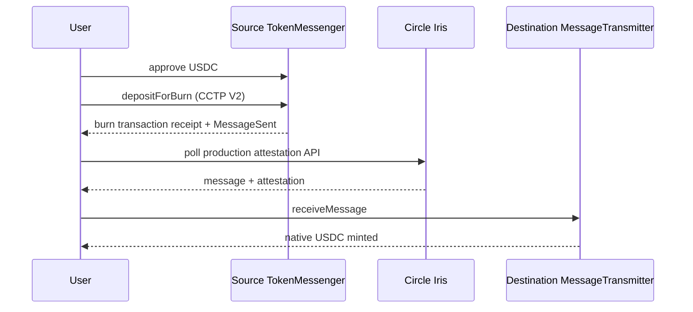

# Arc ↔ Base CCTP V2 Bridge

An open-source, non-custodial reference implementation for transferring native
USDC between **Arc Mainnet** and **Base Mainnet** with Circle CCTP V2.

The standard bridge is live and mainnet-only. Relay, gasless, refuel, and yield
features are intentionally disabled until their separate security and operational
requirements are complete.

> **Mainnet software:** Transactions move real USDC and require source-chain gas
> plus destination-chain gas for minting. This project has not received an
> independent security audit. Verify all addresses against Circle and Arc's
> official documentation before using or modifying it.

## Live scope

| Capability | Status |
|---|---|
| Standard Arc ↔ Base CCTP V2 bridge | Enabled |
| Resumable burn, attestation, and mint | Enabled |
| Relay | Disabled pending reviewed deployment and durable payout processing |
| ERC-4337 gasless mode | Disabled pending provider support and paymaster review |
| Gas refuel | Disabled pending payout verification and funded liquidity |
| Yield | Disabled until a real strategy is selected |
| Testnet runtime | Removed |

No application fee is charged by the enabled bridge.

## Supported networks

| Network | Chain ID | CCTP domain | Native USDC |
|---|---:|---:|---|
| Arc Mainnet | `5042` | `26` | `0x3600000000000000000000000000000000000000` |
| Base Mainnet | `8453` | `6` | `0x833589fCD6eDb6E08f4c7C32D4f71b54bdA02913` |

Circle CCTP V2 mainnet contracts used on both networks:

| Contract | Address |
|---|---|
| TokenMessenger | `0x28b5a0e9C621a5BadaA536219b3a228C8168cf5d` |
| MessageTransmitter | `0x81D40F21F12A8F0E3252Bccb954D722d4c464B64` |

Production attestations use `https://iris-api.circle.com`.

## Transfer lifecycle



The app persists an in-progress session as soon as a burn hash exists. If the
wallet RPC fails after broadcasting, the app checks the authoritative source
RPC and resumes that transfer instead of inviting a duplicate burn.

## Mainnet verification

A real `0.10 USDC` Arc → Base → Arc canary completed successfully:

| Stage | Transaction |
|---|---|
| Arc burn | [`0x987b…31be`](https://explorer.arc.io/tx/0x987bf10c253fbbe4f47b7b25d36cff4bc0f534f01514aebaee78faf5034e31be) |
| Base mint | [`0x1878…6462`](https://basescan.org/tx/0x187802da8e2326eeabc93d1e8e013c7e8fcf6f74cc1bcf33e0a7ff05d3f36462) |
| Base burn | [`0x2e48…19d`](https://basescan.org/tx/0x2e488fdc6614a9fff0921dc02fd9c701290a6bb6b397ffdf14a1dc4cd825c19d) |
| Arc mint | [`0x59cc…bc23`](https://explorer.arc.io/tx/0x59cc578c955a3b7f32e9d985f2e3970d1b2a38d4d8dee4f6f435fd4ed4adbc23) |

See [Mainnet validation](docs/mainnet-validation.md) for the tested parameters,
recovery guarantees, and limitations.

## Run locally

Requirements: Node.js 20+ and pnpm 10+.

```bash
git clone https://github.com/osr21/arc-relay-bridge.git
cd arc-relay-bridge
pnpm install
pnpm --filter @workspace/arc-bridge run dev
```

The standard browser bridge does not need a deployer key, API key, or backend
signer. Optional server and contract-development variables are documented in
`.env.example`; real values must remain in secret storage.

```bash
pnpm --filter @workspace/arc-bridge run typecheck
pnpm --filter @workspace/scripts exec tsx --test \
  ../artifacts/arc-bridge/src/lib/bridge.mainnet.test.ts
```

## Documentation

- [Architecture and product scope](docs/overview.md)
- [Mainnet validation](docs/mainnet-validation.md)
- [Technical reference](docs/technical-reference.md)
- [Development guide](docs/development.md)
- [Contributing](CONTRIBUTING.md)
- [Security policy](SECURITY.md)
- [Deferred relay protocol](docs/relay-mainnet-protocol.md)

Testnet contracts and experiments may remain in the repository for historical
development work, but they are not imported by the mainnet runtime and are not
part of this release.

## Official references

- [Connect to Arc](https://docs.arc.io/arc/references/connect-to-arc)
- [Circle CCTP contract addresses](https://developers.circle.com/cctp/references/contract-addresses)
- [Circle USDC addresses](https://developers.circle.com/stablecoins/usdc-contract-addresses)
- [Circle CCTP overview](https://developers.circle.com/cctp)
- [Base network information](https://docs.base.org/get-started/connect-to-base)

## License

Apache-2.0. See [LICENSE](LICENSE).